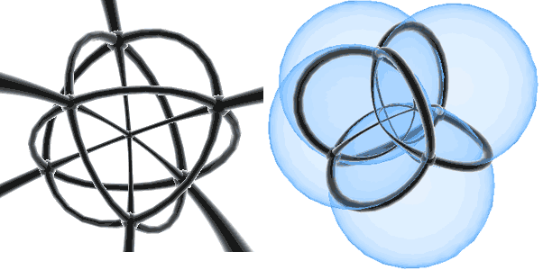

// 注：本文中提到的几乎所有的四维物体的滚动模拟都可在Tesserxel示例中的物理世界->不规则物体滚动中找到，并可使用T/G/F/H/R/Y控制物体滚动。

三维空间中有一些奇奇怪怪的能滚动的东西，比如[Maker's Muse的这个视频](https://www.youtube.com/watch?v=fRqwYsfiME8)中提到的[Oloid](https://zh.wikipedia.org/wiki/Oloid)、[Wobbler](https://makersmuse.podia.com/oloidsandwobblers)、[牟合方盖](https://zh.wikipedia.org/zh-hans/%E7%89%9F%E5%90%88%E6%96%B9%E7%9B%96)等几种图形。我们来尝试把它们类比到四维，并深入了解牟合方盖的四维衍生物。

## Wobbler
Wobbler可以算这几个奇怪的图形中最好理解的图形了。它是斜着切圆柱产生的图形，两端是斜椭圆柱，这样滚动时就看起来在摆动，压痕也实实在在是蛇形的。这个图形的凸包就是个圆柱体，物体接触平面地面时，其凹陷的地方是没有机会接触地面的，所以它跟它的圆柱形凸包的滚动特性是完全一样的。
### 球柱推广
这东西推广到四维有球柱和圆柱柱两种情况。球柱的侧视图是个圆柱，我们直接选择三维空间中砍出Wobbler的平面，然后再跟垂直与侧视图的投影方向张成平胞，这样这些胞就能砍断球柱得到四维的球柱Wobbler。这个东西同样可以看作三维的Wobbler沿同时包含两边斜着的椭圆的长轴所在的平面为轴的旋转体。可以[点击这里](/tesserxel/examples/#rigids::wobbler1)在Tesserxel中看到四维球柱Wobbler的滚动模拟。
### 圆柱柱推广
球柱Wobbler的滚动自由度是2，圆柱柱、双圆柱的滚动自由度是1，且在二维的两个方向上都是柱化方向，我们不必只让它滚起来的时候像刚才Wobbler那样只沿一个方向偏移，而可以让压痕做二维空间中的移动。我当时就想：能不能弄一个压痕是三个圆的图形，滚动一周后，三个圆形的压痕正好旋转了120度呢？这三个圆周扭转连接后形成了一个整体，所以不再需要中间轴来连接。三个圆不够简单、基本，我们还不如直接改成考虑四维空间中的那三个圆周缩小成点的凸包滚动。这样整个图形变成了一种环面扭结——即双旋转的转速比为有理数产生的轨迹。

这时的凸包有两种摆放方式，第一种是跟上面的行为相符的一个三角形的压痕(对应三个圆形缩小为三角形的顶点)，像柱体那样沿直线滚动，且滚动过程中三角形不断旋转。注意它滚动时只在前进方向和竖直方向张成的平面上做单旋转，那个三角形只是压痕在自转，整个物体是没有转动的，这跟Wobbler的摆动的旋转轨迹类似，也跟四维物体[polytwister](https://polytwisters.com/)(很多圆柱柱交得，或取很多Hopf纤维圆周的凸包)的滚动类似。

它侧放后还有另一种滚动模式：凸包侧放后只跟地面在两点接触，形成类似双圆锥那样的滚动模式。我觉得这种东西没准会被四维世界的小孩子当成铁环来滚，它不像我们世界的三维铁环容易倒，且就算倒了也能继续滚。

更一般情况是正p边形滚动一周后旋转了p/q圈，轨迹为p,q-环面扭结。刚才是p=3，q=1的情况，但轨迹没有打结，如果把旋转120度重合改成转240度后重合，则对应p=3，q=2的情况，此时是个三叶结。三叶结的滚动模式和刚才是一样的，但p/q参数都大于2能形成多边形后，那种类双圆锥的2自由度滚动就退化掉了，比如对于3,5-环面扭结，如果是3周期的旋转平面那侧着地，则压痕是个三角形，且向前滚动时三角形会开始旋转。把这个凸包转90度，让5周期旋转平面的那侧着地，则压痕变成了一个正五边形，滚动时就是五边形边旋转边滚动，这几乎就是双圆柱的滚动模式——环面扭结顾名思义是平圆环上的扭结，当参数复杂后，整个图形越来越接近平圆环的凸包，也就是双圆柱了。更极端的情况是双旋转角速度比为无理数时，两旋转平面上所有的相位组合都会稠密遍历，会完全变成双圆柱的滚动模式。

## Sphericon与Oloid

在三维空间中，把正方形的对角线作为轴旋转得到一个圆双锥。我们把它对半切开，然后把一边旋转90度再粘回去，就得到了这个叫Sphericon的图形，直译过来就叫球锥，但注意跟四维的球锥(Sphone)要区分开，我建议叫“球形锥”。它也可以看成是两个垂直的共用圆心的半圆的凸包。

类比到四维，最简单的方法是直接由Sphericon绕一个半圆所在平面为轴旋转升维得到一个一边是球锥一边是双圆锥的图形，它们的公共粘合部分是一个圆双锥。我们可以用球极投影标出球锥的球面和锥点的位置，以及双圆锥的两个圆周的位置：球锥那一半的压痕对应一个端点固定在蓝色半圆（过极点投影后变成射线）的端点处，另一个端点在半球面上做自由度为2的标准球锥模式滚动，而双圆锥那一半对应着一个端点在红色圆周上自由滑动、另一个端点在蓝色圆周上自由滑动的2自由度运动。这两部分都是自由度为2的滚动，其滚动路径有无穷的可能，不像三维的Sphericon那样只有一种固定的滚动路径。

还有一种叫Oloid的几何体，它是一个环扣的凸包，其中两个圆垂直，且正好一个圆的圆心落在另一个圆周上：取凸包后，每个圆只有240°的弧在外面，剩下120°被包在里面了。它的滚动看起来不太好理解，但其滚动模式类似于Sphericon，但外形更加圆润，没有Sphericon的尖尖的锥点。它滚动起来也有点像Wobbler那样看起来在地上蛇形滚动，压痕在地上扫略出的图形是这个样子的：这东西在机械上还有些特殊的用途，可参见[《不可思议的Oloid搅拌器，造型独特，但能节省70%以上的能耗！》](https://www.bilibili.com/video/BV1ZsZjBpEdD/)这个视频。<!--https://www.youtube.com/shorts/UCqYCOjloLk-->

Oloid自然可通过旋转升维成球-圆链的凸包，即选取一个圆周为平面轴得到的旋转体。除了旋转升维这种粗暴的方式，还有没有其它可能呢？对于Oloid来说它的定义太特殊了，我还没想到其它四维类比，但对于Sphericon来说还可以挣扎一下，我们之前的旋转升维法得到的是2自由度的滚动，如果放弃一个自由度则Sphericon还有更多的四维类比。
### 更复杂的Sphericon
三维的Sphericon还有一些变种，比如六边形Sphericon，它是正六边形绕对角线旋转后切开再旋转错位拼回去的产物。多边形的对称轴除了对角线还可以是对边的中点连线，绕这种连线旋转会让包含中点的那条边形成一个平的圆周，不能像其它锥面那样接触地面滚动。下面左边的图形是把正方形的对边中点作为旋转轴旋转、切开、扭转90度、粘和得到的图形，即两个半圆柱拼在一起的图形，可以看到半圆周是滚动的终点，所以在设计Sphericon时应该尽量避免跟转轴完全垂直的线段。此外其它的有正多边形对称的图形也能做Sphericon，比如下面的齿轮形的东西，当然它的滚动跟正八边形（下图中间）的滚动是一样的。到了四维可以选择正多面体，然后绕某个旋转平面旋转360°后切成两半，然后把旋转平面旋转到另一个位置上拼回去。我设想了5个正多面体的“超球形锥”——Hypersphericon，并分别标出了两半的旋转平面的位置。立方体的这个对角面旋转其实得到的是两个半个圆双锥柱旋转粘合的产物，而正四面体的则是两个半个圆锥锥旋转粘合的产物，正八面体的则是两个半个圆柱双锥旋转粘合的产物，而正12和正20面体对应的四维物体就太复杂了，但它们能由一些基本的圆的柱锥组合体通过布尔运算得到。这些图形能否连续滚动呢？建议读者可先自行思考一下。

我们可以在上图中来分析：滚动180°后，跟地面接触的表面就会转到平面轴的另一侧镜像的位置，然后就会换成绕另一个旋转平面轴转180°，再次镜像……物体滚动时，压痕就在上图的视图中被两张平面交替反射，会出现以下两种情况：
1. 整个反射形成循环，这代表着物体可以无限滚动，跟最简单的菱形对角线的那样可持续蜿蜒滚动的Sphericon类似；
2. 出现压痕所在的面垂直于平面轴的情况，此时这个面不再是锥面，物体滚动至此只能倒转，跟那个正方形绕对边中点旋转的情况类似。

我们换个视角，从两个平面的交线方向看这些图形，这样这些曲面就相当于绕着中心在进行有着正多边形对称性的旋转和反射。标出垂直于旋转平面的面，它们会被反射到其它对称位置，这些位置着地后都无法连续滚动，只有随便怎么反射都不会跟旋转平面轴垂直的面才能一直丝滑滚动。对5种图形逐一分析后，答案就出来了：高亮的表面跟某平面垂直，无法滚动；有红色箭头的平面虽不垂直，但会随滚动转到垂直的面上去，换轴后无法连续滚动；绿色箭头则形成可持续滚动的闭合圈。结论是：上图五种图形中只有那个正二十面体Sphericon才能连续滚动。Tesserxel中的示例已默认让正二十面体Sphericon以能一直滚动的方式放置。把视图切换到水平截面模式，并把相机的高度调整至比地面高一点点，就能够看到压痕是个有一定厚度的三角形，它不断在移动、旋转，轨迹是个飘忽不定的空间曲线，十分漂亮。这个三角形颜色偏暗，是因为水平截面截取的是三维体素画面中物体底部的像素，那里光照自然就会黑一些。看到这里不禁想问，它的质心运动的轨迹到底是什么图案？整个轨迹是闭合曲线吗？显然它们是锥柱面滚动形成的很多圆弧形路径拼在一起的，但计算具体弧长角度有点繁琐，这个问题就交给有兴趣的读者吧。

值得说明的是，五种正多面体的旋转平面不一定只有我这里的取法。所有的取法可以按两平面的交线过顶点、过棱心、过面心来分类，这样算来每种正多面体都有三种不同的Sphericon（其实正四面体的顶点、面心取法是等价的，说明还要排除一些图形），说不定还能够得到其它能够连续滚动的图形。
## 牟合方盖
牟合方盖最初在古代就是用来计算球体的体积的，可以说它天然就是用截面动画来定义的：球的截面动画是圆按照截圆周的尺寸变化规律先变大再变小，它则是一个正方形按照截圆周的尺寸变化规律先变大再变小。截面动画也能看出来它是两个垂直等大圆柱的交集：把正方形的四条边延长就能看出这两个圆柱的截面动画。下面再以凸包的视角来理解牟合方盖：牟合方盖可以看做xy平面和yz平面上的两个圆的凸包。但牟合方盖的原始定义是两个等大垂直的圆柱体的交集，它的棱（上图中的紫色圈）其实是两个垂直的长短轴比为$\sqrt{2}$的椭圆，而不是正圆，所以严格说牟合方盖是两个垂直的**椭圆**的凸包。**如果直接用正圆做凸包，表面反而是椭圆柱面**，由于椭圆滚动的重心会发生变化，不再能持续丝滑滚动，因此涉及到滚动时要格外注意这个缩放关系。

牟合方盖有两个圆柱面，滚动时一般只有一个面接触地面像普通圆柱那样滚动，但有个两特殊的点，两个柱面不仅在此相交，且切面也重合，意味着在这个位置可选择换成另一个垂直的方向来滚动。从它在二维桌面上的压痕的结构上能够看到这个交点处的压痕是个很小的正方形，此时向正方形的两个边方向都可滚动，选择某个方向滚后，另外垂直的那边的方向就会变长。

下面来把牟合方盖类比到四维。
### 牟合立方盖
牟合方盖至少有截面法、交集法和凸包法三种理解方式，因此牟合方盖在四维的推广非常多，最简单的是**牟合立方盖**。它对应一个立方体按截圆的规律先变大再变小。它还能看作四维空间中一些柱体的交集吗？答案是肯定的。我们把立方体的六个面延伸，截面动画中每两个平行的平面组成一个圆柱柱，所以牟合立方盖是三个朝向xy/yz/xz平面内的圆柱柱的交。其实也可以说是双圆柱的交，因为只要双圆柱的另一个圆足够大就不影响它跟其它物体相交的行为。后文提到圆柱柱相交时默认都可换成双圆柱。

牟合立方盖是什么图形的凸包呢？由于截面动画是个立方体变大、变小，我们只需要把支撑起立方体的八个顶点把握住就行。由于尺寸是按截圆来缩放的，八个顶点的轨迹都是圆周，但体对角线上的一堆顶点其实是在一个圆周上的，因此牟合立方盖对应4个圆周的凸包。其实凸包与截面动画有个关系：**截面动画的凸包等于凸包的截面动画**。牟合立方盖滚动起来跟圆柱柱/双圆柱的滚动类似，只能朝一个方向滚动，滚到三个圆柱柱的交集点上时（即上面动图的短暂停顿时刻）就有正负x/y/z/轴6个滚动方向可供选择。这个点处的压痕是个小正方体，往哪个面的方向滚动，哪个面就会变大，整个压痕变成薄的正方形片。
### 牟合正八面盖
除了正方体，正方形还可以走正轴形路线推广到正八面体。牟合正八面盖是正八面体按截圆的规律先变大再变小。由于正八面体有4组平行的平面，结合截面动画可知它是四个圆柱柱的交集。牟合正八面盖是什么图形的凸包呢？跟牟合立方盖类似分析可知，它是三个垂直的圆周的凸包——即xw/yw/zw平面上的单位圆的凸包。这个东西滚动时的自由度也是1，它的压痕一般是个薄的正三角形，滚向特殊点的过程中三角形开始缩小，考虑上压痕厚度的话，薄片靠特殊点侧比另一侧先缩小，压痕其实是个三棱台，最后靠特殊点侧的三角形会先缩成一点，然后变成反着的三角形，最终物体中心落在特殊点上时，压痕是个正三角反棱柱，恰好变成完美的正八面体，此时可有8种（4对）不同的滚动方向选择。

### 牟合圆柱盖
开始越来越抽象了。牟合圆柱盖可以看成什么东西的交集？请读者先自行思考，我们稍后揭晓答案。凸包方面，它也有类似双圆柱那样的二维棱，即它是自己的棱的凸包，但这个二维棱比较复杂，不太好看做更简单基本的图形。牟合圆柱盖的滚动其实是比较有意思的了。首先能想出来的就是跟正八面体、正方体的牟合盖类似的圆柱-圆台压痕：有趣的是，经过特殊点后就可以选择圆柱底面着地或侧面着地，刚才只是底面着地的情况。侧面着地的情况变得复杂了起来：牟合盖本身在一个方向上就是像圆那样弯曲的，可以滚动，同时圆柱面自身也是弯曲的，或许此时物体滚动的自由度会从1上升到2？我们最好弄清楚它由什么图形相交得到才好了解滚动性质：设牟合圆柱盖的圆柱的底面圆平行于xy平面，高为z轴方向，沿w轴的截面动画能够看出它是一个圆柱变粗变细跟一个平面变厚变薄的交集，说明是在xy平面方向的圆柱柱和在z轴方向的球柱的交集。圆柱柱和球柱正好对应两种滚动模式，自由度也对上了。球柱模式下这个压痕可以在垂直于左右方向的任何方向上移动，对应2自由度，在特殊点时压痕变成圆柱，还可以向左右方向移动，变成前面的圆柱-圆台模式。

### 二重牟合方盖

再下一个图形本来该叫牟合-牟合方盖-盖，这样套娃太拗口了，我叫它“二重牟合方盖”。顾名思义，它的截面动画是牟合方盖按照截圆的那种缩放比例来出现变大变小再消失的。这东西由两个球柱相交得到：已知牟合方盖就是两圆柱相交。加上那种变大变小的截面动画后，说明它是两根同时从细变粗再变细消失的圆柱的交集，这就是典型的两根球柱的截面动画。二重牟合方盖为什么会出现球？一句话说就是“牟合圆盖就是球”。牟合方盖可理解为xy方向是方形、z方向是圆形的东西。现在w轴再“牟合”一次，则得到xy方向是方形、zw方向是圆形的图形。注意这东西它不是即绝对垂直的正方形和圆的凸包（即4,圆-双锥），凸包在中间的xz/yz/xw/yw平面上都是菱形，而二重牟合方盖在这些平面上都是圆周。实际上它是两个共球心的垂直的球的凸包，比如两球分别位于xyz/yzw空间中，xw平面内看它就是方形，yz平面看它就是个圆。

二重牟合方盖的滚动也比较抽象。它是两个共球心的垂直的球的凸包，这东西放地面上两头就会产生球面放在桌面上的微小圆形的压痕，这东西跟牟合圆柱盖侧面着地的滚动太像了，只是滚动到特殊点附近的压痕的微小形状有些差异，我们再把之前的图放过来对比一下：这种类似性是有原因的：二重牟合方盖是两球柱相交得到，牟合圆柱盖是一个球柱跟一个圆柱柱相交得到，都把球柱面的那端放到地面上滚动，行为自然会很相似了。二重牟合方盖还有个有趣的性质，那就是它的特殊点不再是一些孤立的点，其集合是整个一维的圆周，这个圆周正好是两个共球心的垂直的球的交圆。在特殊点处，二重牟合方盖有三种滚动方向可选择：有两个方向会让牟合方盖的两个圆分开，变成类似圆柱的棒状压痕，第三个垂直的方向则会让压痕始终保持牟合方盖的形状，即沿特殊圆周一直滚动，物体始终处于特殊点。
### 圆球凸包与旋转体
三维空间中两个垂直的圆的凸包是牟合方盖，到了四维可以在xy平面摆圆、在yzw空间摆球来取凸包。它也是一种牟合盖，请读者猜猜看它是把什么三维图形牟合得到的，答案稍后揭晓。也可以用旋转体的视角来解释：取下图中任意一个紫色圆周所在平面为轴的牟合方盖的旋转体，也能得到刚才说的圆球凸包。牟合方盖还有两种旋转升维的方式：一种是上图中选中间最大的蓝色正方形所在的平面为轴旋转，此时这两个圆柱都被旋转成球柱，即之前说的二重牟合方盖，不产生新的图形，另一种则是绕图中的绿色圆周所在平面为轴旋转得到的图形，它其实也是之前早就提过的一种牟合盖，这里同样先留给读者思考。

从上图绕紫色圆周所在的平面轴的旋转体出发我们还能得到圆球凸包的另一种解释：由**截面动画的旋转体等于旋转体的截面动画**这条规则可知，这个旋转体等价于正方形沿对角线旋转的旋转体（即圆双锥——两个倒扣的圆锥）的牟合方盖，所以这个**圆和球的凸包其实是牟合圆双锥盖**。牟合圆双锥盖是目前唯一不能由圆柱柱或球柱交集生成的，因为它的表面是由倾斜45度的圆柱面绕旋转平面轴生成，是个介于球柱侧胞和双圆柱胞(亦即圆柱柱侧胞)之间的东西，它兼具柱和锥的一部分特性，个人认为用球跟其半垂直的圆的凸包来解释反倒最简单了。

下面揭晓牟合方盖绕绿色的圆周所在平面旋转得到的图形，有两种推导方式：
1. 由**截面动画的旋转体等于旋转体的截面动画**这条规则可知，牟合方盖的旋转体等于正方形旋转体的牟合盖，正方形的旋转体是圆柱，所以这个图形是**牟合圆柱盖**；
2. 直接看表面旋转后变成的东西：蓝色线段所在的圆柱面旋转后变成双圆柱的侧面，局部也等价于圆柱柱的侧面；而红色线段所在的圆柱面旋转后变成球柱面，说明这东西由圆柱柱侧胞和球柱侧胞共同围成，这显然也就是牟合圆柱盖。

现在再来看看最抽象的牟合圆双锥盖的滚动，它有两个滚动自由度：
1. 由于三维空间中圆双锥的滚动跟普通圆锥一样，把牟合圆双锥盖侧放让中间的“腰部”着地，此时只要不向牟合的盖子方向滚动，则它的滚动模式就会跟圆锥柱那样：凸包中的圆和球分别在两头产生一个小线段和一个小圆的压痕，圆锥柱的滚动模式会让整个压痕绕着圆周所在的小弦断旋转着滚动。
2. 它也能从中间的“腰部”着地位置出发，向特殊点滚动，这是牟合盖的圆形赋予给它的滚动自由度，模式更像一般的1自由度滚动的柱体：整个压痕向线段和圆的公共方向平移，不过离开“腰部”位置后，线段与圆圈不再平行，它们距离不断缩短且家教变大，最后距离缩小到0，角度垂直，压痕变成圆双锥，整个图形也就到了特殊点的位置，此时可以向垂直于锥面上任意一根母线的方向滚动。牟合圆双锥盖由两个三维曲胞围成，对应圆双锥上下两部分的分别球化牟合，只有经过特殊点时才能切换哪个曲胞着地。

我只能推断锥的滚动模式在中间的“腰部”着地位置时是相当平稳顺滑的，但当它离开中间腰部向特殊点滚动到中间的位置时，圆周与小线段是倾斜的，锥的滚动模式还能不能顺滑呢？我承认自己完全想不出来了，但幸好还有Tesserxel物理引擎救场，结果是仍然可以顺滑旋转滚动，只是每次旋转滚动都会自发叠加一些平移滚动，我不确定是我模拟操作时没对准导致有平移滚动的速度分量，还是说这东西的几何性质就会让它把斜着的旋转滚动转换成平移滚动，我更倾向于大概率是后者：由于这个旋转是绕一端的线段压痕为轴，纯旋转滚动按理说整个压痕会扫掠得到一个锥面，但旋转所需要的向心力（图中红色力）的一个分量正好是平移滚动的方向（灰色虚线方向），这个方向让自然没办法提供摩擦力，最终物体只有黑色箭头方向的摩擦力提供向心力，于是惯性会让物体不老老实实按锥面的方式旋转滚动，把物体沿灰色虚线方向从锥面上甩开，自然获得这个方向平移滚动的速度分量，且这个平移滚动的方向始终让物体朝远离特殊点的方向滚动，跟Tesserxel引擎中的模拟结果一致。
### 多柱体交集

三维空间中，三个方向互相垂直、半径相同的实心圆柱相交，其组合结构为菱形十二面体，但每个“面”是圆柱面片，而不是平面菱形。三个垂直的圆柱相当于构成了穿过正方体所有面心（也可以说穿过正八面体所有顶点）的对称结构，其它正多面体对称性的情况如何呢？[Paul Bourke的这个网站上](https://paulbourke.net/geometry/cylinders/)列出了三维空间中所有的正多面体对称性的圆柱相交的交集：自然的问题是，之前我们的圆柱柱/球柱只按立方体/正方形对称性排列，如果按超立方体或其它正多胞体排列，中间图形的骨架会是什么样呢？具体来说是：

- 线状的球柱：在正多胞体每个顶点与体心的连线上放置球柱，取交集；
- 面状的圆柱柱：在正多胞体每条棱与体心张成的平面上放置圆柱柱，取交集。

四维空间有6种正多胞体，一共对应12种交集。这个问题看上去太难了，我最先想到的就是利用正多胞体对称性，像盲人摸象那样只分析特殊位置处的情况把整个图形摸出来，比如推导三维空间中三个互相垂直的圆柱的交集：设三个沿坐标轴的圆柱半径为1，它有立方体/八面体对称性，设立方体顶点坐标为(±1,±1,±1)，我们用一些特殊对称位置上过原点的射线来试探这个交集：

- 立方体顶点方向，设射线跟物体交点为 $(a,a,a)$。它到三个圆柱轴的距离平方相同，均为 $2a^2$，所以此处为顶点，坐标满足$2a^2=1, (a,a,a)=(1/\sqrt2,1/\sqrt2,1/\sqrt2)$
- 立方体棱心方向，设点为 $(a,a,0)$。$x$/$y$两圆柱面在 $(1,1,0)$ 处相交，但 $z$ 轴圆柱只需到 $(1/\sqrt2,1/\sqrt2,0)$ 就到达边界，更靠近原点，交集取最内层。注意最内层只有 $z$ 轴一个圆柱参与，所以棱心方向对应曲面片内部，相当于对偶多面体的面心。
- 立方体面心方向，设点为 $(a,0,0)$。它完全在 $x$ 轴上，即位于 $x$ 轴圆柱内部，可忽略；其余两圆柱在此相交成一个顶点，即牟合方盖的特殊点。

综上，整个图形在立方体顶点方向为三度顶点，在面心方向为四度顶点，在棱心方向对应曲面片内部（对偶多面体的面心），只有菱形十二面体符合。菱形十二面体的两类顶点在这里有很大区别：正方体顶点处是真正凸起的棱角，而面心特殊点处是平的。由于特殊点的存在，连续滚动的过程中整个图形的所有表面都有机会接触地面，但物体的滚动自由度为1，滚动时质心向下投影到物体表面能到达的地方的集合是下图中红绿蓝三个圆周，交叉点自然就是特殊点：

把这个方法扩展到四维就能推出坐标轴上四个球柱相交和坐标面上六个圆柱柱相交的情况，但推导过程既繁琐也不直观，读者可[点击此处展开推导过程](javascript:$('#4sph6cub').toggle())。这个过程与其说推导，不如说是通过对称性猜对的，而其它的正多胞体对称性不在坐标面上还这样代特殊位置去推导就更繁琐了，必须要找更高效直接的分析方法。

 

#### 坐标轴上球柱相交
下面推导四维空间中四个互相垂直的单位半径球柱的交集。

- 顶点方向，设点为 $(a,a,a,a)$。它到四个轴的距离相等，故为顶点。代入球柱面方程（如w轴球柱面方程为$x^2+y^2+z^2=1$）得$3a^2=1, a=1\sqrt3$；
- 棱心方向，设点为 $(a,a,a,0)$。它到 $x$/$y$/$z$ 轴的距离相同，代入方程（如x轴球柱面方程为$y^2+z^2+w^2=1$）计算得到 $a=1/\sqrt2$；同理到 $w$ 轴的距离更靠近体心，为 $a=1/\sqrt3$。交集取最内层 $w$ 轴球柱表面，因此此处对应球柱胞的胞心。
- 面心方向，设点为 $(a,a,0,0)$。距离可分两类：到 $x$/$y$ 球柱面为 $a=1$，到 $z$/$w$ 球柱面为 $a=1/\sqrt2$。$x$/$y$ 球柱面在外面更远，里面 $z$ 轴和 $w$ 轴两个球柱面在此相交。这里的相交模式是二重牟合方盖，即两个球面相交于一个圆周，得到的是一维棱，整条棱上都是特殊点。
- 胞心方向，设点为 $(a,0,0,0)$。该点完全位于 $x$ 轴的球柱体内部，不参与形成表面；剩下 $y/z/w$ 三个球柱面在此平分，在胞心形成顶点，这里其实是把刚才三维的三个圆柱交集的那个曲面菱形十二面体再做一次牟合的特殊点。由于菱形十二面体的顶点在正方体面心和顶点处，所以这里的胞心会向面心和顶点方向发出棱，顶点的度数为6+8=14。

总结：该图形的顶点位于超立方体的顶点和胞心，棱位于面心，胞位于棱心，分析可知它是截半超立方体的对偶多胞体。

#### 坐标面上圆柱柱相交

下面推导四维空间中六个互相垂直的单位半径圆柱柱的交集。

- 顶点方向，设点为 $(a,a,a,a)$。它到六个坐标面的距离相等，故为顶点。代入圆柱柱方程（如$xy$平面上的圆柱柱方程为$z^2+w^2=1$）得
$2a^2=1,a=1/\sqrt2$
- 棱心方向，设点为 $(a,a,a,0)$。它到坐标面的距离分两组：$xy$/$xz$/$yz$ 一组，$xw$/$yw$/$zw$ 另一组，对应的 $a$ 分别为 $1/\sqrt2$ 与 $1$。即 $xy$/$xz$/$yz$ 三个圆柱柱更靠近体心，所以此处对应三个圆柱柱相交得到的牟合立方盖，$(a,a,a,0)$在牟合立方盖这里的模式对应立方体的一个顶点被牟合成圆周，即一个一维棱，且棱的走向沿$w$轴，与原超立方体的棱走向一致。
- 面心方向，设点为 $(a,a,0,0)$。距离分三类：到 $xy$ 为 $0$、到 $xz$/$yz$/$xw$/$yw$ 为 $a$、到 $zw$ 为 $1/\sqrt{a}$。由于面心方向位于 $xy$ 圆柱柱的轴线上，所以 $xy$ 圆柱柱不参与形成交集表面，另两类距离分别为 $a=1$ 和 $a=1/\sqrt2$，$zw$平面上的圆柱柱取到最里面的$a=1/\sqrt2$，因此这里对应圆柱柱表面，即胞心。
- 胞心方向，设点为 $(a,0,0,0)$。该点完全位于平面 $xy$/$xz$/$xw$ 上的圆柱柱内部，不参与形成表面；剩下 $yz$/$zw$/$yw$ 三个圆柱柱在此平分，在胞心形成顶点，相当于牟合立方盖的特殊点。

总结：该图形的胞心位于超立方体的二维面心，而顶点位于超立方体的顶点和胞心，显然该图形为正24胞体。

#### 规律探寻
Paul Bourke除了研究了正多面体的情况，他还尝试了选择了很多根随机朝向的圆柱来相交，发现要不了很多圆柱交集就能非常接近球形。这个球面上的花纹引起了我的注意：同一个圆柱面可能会被分成非常多的区域，但它们都通过特殊点相连成一个环形的大圆，这里藏着支配表面结构的规律。把所有圆柱朝向的法平面交球面的大圆都画出来，让球面上每一点都去“认领”距离最近的大圆，把整个球面划分掉，形成类似Voronoi图的东西就是这些柱体相交的结果，同时这些大圆还是滚动时质心投影的轨迹，大圆之间的交点就是可以换滚动方向的特殊点。这个例子说明，有时候并不是要先理解最简单的图形后再理解更复杂的图形，可能顺序恰好相反，只有图形足够复杂时规律才能更好显现。

#### 坐标轴上球柱相交

到了四维空间球柱的柱化方向是一维的，它的法空间交超球面于球面，如果球柱都沿坐标轴，则这些球面自然就会画在垂直于轴的坐标胞上，即所有的四个坐标胞上都有一个大球面，可知该交集图形滚动时质心投影的轨迹就是这四个球面，即正16胞体的二维面的膨胀到超球面上的结构，这正好跟球柱滚动的2自由度相符。正16胞体的所有棱，即球面相交得到的圆周都是特殊点，这里可以换方向前往不同的的球面，滚动行为等价于二重牟合方盖的特殊点。超球面上的其它点按离最近的大球面来划分区域，这些划分的胞心自然是正16胞体的每个面心处，根据对偶关系也等价于在超立方体的棱心处。这个图形或许有点抽象，但它的对偶多胞体则是所有顶点位于棱心，明显是截半超立方体，根据截半超立方体的顶点图可知，该交集的整体框架形状是一个由32个全等的三角双锥胞围成的四维多胞体。

我在Tesserxel中用类似球极投影的视角画出了四个球柱面的交织结构，下图中左右是双眼裸眼3D，不会看可忽略，上下是同一体素画面的两个三维视角：黄色的区域是某个球柱胞，第一行可以看到取了交集后它被分成了8份，其中有4份在画面中，外面的4份则靠近投影的极点无法在体素画面中显示，结合第二行可知每份都是一个中心在超立方体框架棱心的三角双锥。超立方体的棱有四个垂直的方向，正好分成4组，每组对应属于一个球柱表面的8个三角双锥。从第一行图中还可以看到，分隔同一个球柱表面的8个三角双锥的是三个垂直的圆周，这些圆周是球面相交得到的，因此都是特殊点，它们会经过超立方体的面心，跟之前分析的结论一致。圆周质心的投影永远到不了三角双锥的两个锥点，即超立方体的顶点处，这里跟三维的牟合方盖类似是凸出来的。
#### 坐标面上圆柱柱相交

对于圆柱柱，它柱化方向是二维的，绝对垂直于柱化方向的平面交超球得到圆周。这些圆周自然都在坐标面上，因此质心投影的轨迹对应的圆周组成膨胀到超球面上的正16胞体的所有棱，同时超球面上的点按照最近的圆周来划分区域，正16胞体的每个棱心变成了划分区域的胞心，根据对偶关系也就是超立方体的面心是划分区域的胞心，这样的图形就是正24胞体的结构。正24胞体本来是高度对称的图形，原超立方体的胞心跟顶点处都是正24胞体的顶点，且它们不再有任何区别。然而圆柱柱产生的交集有着形似正24胞体的框架，但却没那么对称：原超立方体的胞心等价于牟合立方盖的特殊点，但原超立方体的顶点处是真正凸起的顶点。

### 牟合双方盖
到这里是不是所有典型的牟合方盖的四维类比都弄完了呢？不是的。类似于圆环环和双圆环，既然有二重牟合方盖（牟合-牟合方盖-盖），那就还有一种叫“牟合双方盖”的东西。在具体构造它之前，我们先一睹为快它滚动的压痕变化：通过压痕可以猜出来它的滚动自由度以及特殊点的位置与对应可选择的滚动方向。它是xz/xw/yz/yw四个平面上的圆柱柱相交的产物。为什么要这样选所有6个坐标面中删掉绝对垂直的两个平面剩下的4张的组合呢？系统理解牟合双方盖需要一些新的构造图形的方法：括号体和砖积。这些内容该属于四维几何学，而不是四维世界物理了，我们下期接着聊。
## 滚动模式总结
是时候把这么多可滚动的图形的滚动模式总结一下了。首先看最简单的单一自由度的旋转体的滚动。在旋转体中，接触地面的胞一般由一个平面旋转生成，它旋转平面轴的位置关系来分类：
- 接触平面垂直于旋转平面轴：此时该面旋转后得到一个平直的三维胞，无法滚动。
- 接触平面平行于旋转平面轴：这个平面旋转后得到柱体，比如矩形面旋转得到圆柱柱、圆形面旋转得到双圆柱的侧面，它们都是1自由度的平移滚动。最一般的情况是任意的二维图形直积圆得到的四维图形都可以像柱那样滚动。
- 接触平面跟旋转平面轴有倾角：这个平面旋转后得到锥体，虽然圆柱锥、圆锥柱、圆锥锥是不同的图形，接触地面的压痕形状也不同，但它们的滚动模式其实是一样的。

### 锥与旋转体
圆柱锥、圆锥柱、圆锥锥的压痕有什么规律呢？其实已知锥的压痕就可以找到对应的旋转体。先来看看低维的圆锥，它的压痕其实是锥面上斜着的母线，整个物体的旋转轴跟地面形成了一个夹角，导致底面圆的周长小于它滚动形成的压痕圆周的周长。四维的圆锥锥和圆柱锥都是能滚动的锥形，它们的压痕都是三角形，但轴的位置不一样。我们来尝试画它们的包含旋转对称平面的侧视图，跟圆锥的侧视图类似，这个视图压缩掉了压痕的旋转行进方向，引入了竖直方向后，我们可以观察到这些**锥作为旋转体都是压痕向旋转平面轴投影时扫过的区域**。下图中圆锥锥和圆柱锥能与地面接触的部分标浅红色，它们作为旋转体的平面轴为蓝色，三维桌面上压痕的旋转轴为红色虚线。
其实通过旋转体我们还能够得到一些有趣的结论，比如最右边的圆锥柱可以沿矩形对角线切一刀分成一个圆柱锥和一个圆锥锥，但注意这一刀切下去的断面是垂直旋转轴的直角三角形，实际的圆柱锥和一个圆锥锥是被一个圆锥胞分开的。

四维的最一般的锥滚动跟柱柱一样，可自由选择压痕的形状，不过很多处后的滚动更像圆台而不是圆锥。比如这个我叫**双圆柱台**的例子：一个斜切的圆柱绕底面的旋转体，它放在地面上有两种滚动模式：一种锥的那种旋转滚动，另一种是柱体的那种直线，分别对应圆柱的斜切面着地和圆柱的侧面着地。锥体模式滚动时，它的压痕是个椭圆绕着椭圆外的轴旋转，在三维桌面上扫略得到一种类似甜甜圈的形状；柱体模式滚动时，它的压痕是个薄圆片，但圆片的半径随着滚动会不断变化波动，跟下面的三维物体滚动类似。然而跟三维情况一样，这个物体的重心不能保持不变，无法顺滑连续滚动，最终会停留在最大尺寸的侧边着地的位置。这东西有两种滚动模式是因为恰好被旋转的物体本身就有圆柱的能滚动的表面。如果把它换成四棱柱，得到**圆四棱台**，则就只剩下斜切面对应的那个锥的滚动模式了。如果斜四棱柱的边平行于倾斜方向，其实圆四棱台就是圆台柱。还有一种把双圆柱台变有棱角的方法：把构建双圆柱台旋转体操作的步长降低，变成多边形近似，得到比如这个**四棱圆台**。它不再是旋转体，但可以看作四个椭圆的凸包，其中四个椭圆的长轴是四棱台的斜着的棱，短轴则垂直于四棱台所在三维空间，如果长短轴比例合适，它们的侧面可以是标准的圆柱柱面，跟牟合立方盖的情况很像。
四棱圆台还有一种奇怪的极限图形，叫**四棱圆锥**，此时四个椭圆在锥点相切于一点，同样双圆柱台也有双圆柱锥，这个位置也是一种特殊点：虽然看起来跟牟合立方盖或牟合圆柱盖特殊点的情况有点像，但这里是不稳定点：即滚动至此后可切换到垂直方向上运动，但另一个方向上物体不再是滚动而是翻转到能量更低的状态，跟下面的三维图形的特殊点类似。这些图形的滚动模拟都可以在Tesserxel引擎示例库的物理世界->不规则图形滚动中找到。
### 多自由度滚动模式
单自由度的滚动模式其实就只有柱和锥两种。多自由度如何呢？四维物体表面是三维的，最多自由度就是3，对应超球的滚动模式，超球是唯一最平顺的滚动图形了，其它的椭超球虽然自由度也是3，但重心滚动会变化，导致物体最终停留在最低重心状态，滚动不会持续平滑。
二自由度的滚动则是最丰富的。两个方向可以是柱或锥模式，组合下来有四种可能：
- 两个方向都是柱，即球柱模式;
- 一个方向是柱另一个方向是锥，这种组合我曾一度认为不可能，然而之前提到的牟合圆双锥盖就符合这种运动模式。牟合圆双锥盖是斜圆柱面的旋转体，这才导致混合了柱和锥的滚动模式，我估计没有其它的情况了，如果读者有新的发现欢迎一起讨论。
- 两个方向都是锥，但锥的旋转有方向性，比如球锥和双圆锥就对应半垂直和绝对垂直两种情况。

有没有介于半垂直和绝对垂直之间的两个方向都是锥的滚动呢？球锥和双圆锥都是圆锥的旋转体，如果选斜着的锥面能不能得到想要的滚动模式呢？注意不能选得过斜，否则旋转出来的图形不再是凸的，锥体的内侧无法接触桌面，滚动自然不连续，我们不如考虑一种最临界的情况，它可看成绝对垂直的圆周的凸包，但有个圆周的圆心不在原点，而是偏移了刚好一个半径的距离。这个东西的对称性是差了点，它的重心能保持住让滚动一直平顺吗？我在tesserxel中的模拟发现确实不行：它像双圆锥那样滚动，但我也没发现有介于半垂直和绝对垂直之间的滚动模式。相比双圆锥多出来的平移可以让一个圆周有机会完全接触地面，事实上这是一个能量最低的平衡位置，物体会像不倒翁那样在附近摆动，无法再持续滚动，跟对应三维情况上图的物体扔在桌上后，锥的高的线段最终会朝下几乎相同。其实刚才那种该叫**单斜双圆锥**，还有种**双斜双圆锥**：两个圆周所在的平面是绝对垂直的，所以交于一点，每个圆周的圆心都可以在它所在平面内偏离这个交点，如果都偏移一个半径的图形，就得到了同样无法连续滚动的双斜双圆锥，这种临界位置的双斜双圆锥是两个两个绝对垂直的且在某点处相交的圆周的凸包，不再有任何旋转对称性。

### 多滚动模式切换
还有一大类是能多滚动模式切换的物体，它们都是几种不同表面的交集。可分成平滑切换和翻转切换两类：平滑切换要求物体表面存在着几个表面共用相同切面在此相交的特殊点，比如含有特殊点的各种牟合盖，而翻转切换则是一般的相交，比如绝对垂直的两个圆柱柱面相交得到的双圆柱，还有刚才看过的兼具柱和锥滚动方向的双圆柱台，它翻转90度后可切换滚动方向。比如如果想得到能通过特殊点稳定在柱体和锥体模式间切换的话，那就该找某种柱和某种锥的交集，且保证有个交点处有公切面，对应美术生经常画的石膏体组合模型的形状，这个图形明显不再对称，旋转重心变化导致滚动不连续。最后还有种不稳定特殊点：它们不是相交图形本身的三维切胞重合，而是相交产生的交线或交面重合，我们之前看到的双圆柱锥的锥点就属于这种情况。

## 思考题

下面留给读者一道有些挑战性的思考题：取三个位坐标于原点，朝向分别为xy/zw、xz/yw、xw/yz的等大的双圆锥的交集，该形状是什么样的，这个图形上有没有相切的特殊点？该物体滚动时重心向接触面的投影的集合是什么样的？提示：可以想一想下面这个三维物体是怎么来的。